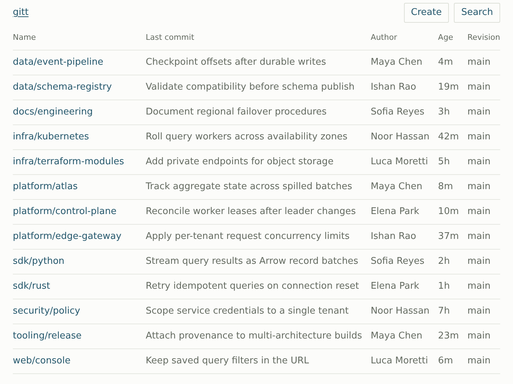
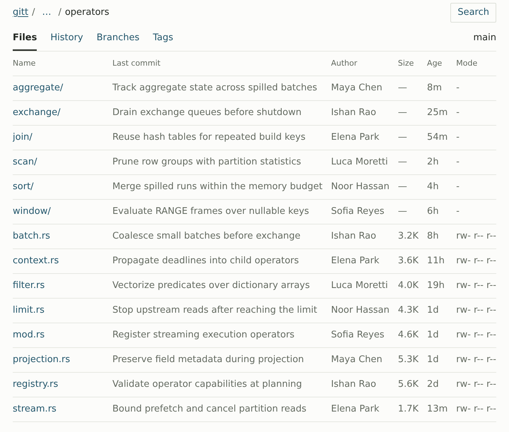
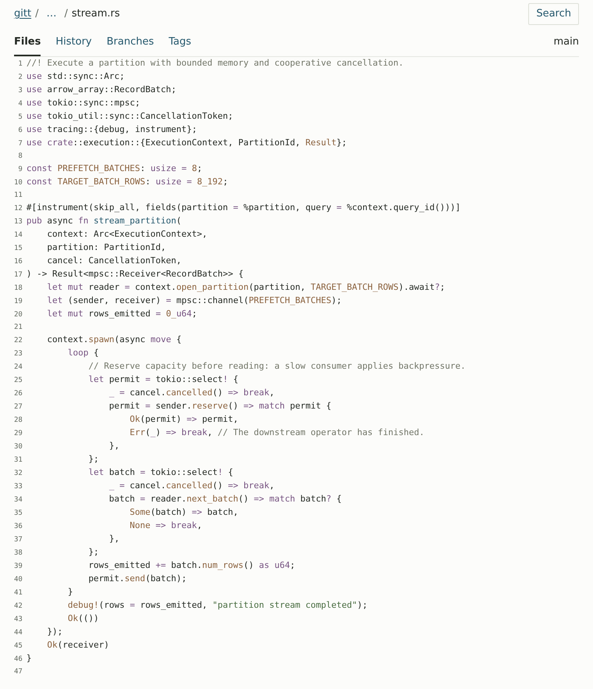

# gitt

A web interface for browsing Git repositories.



- Browse files, history, branches, and tags.
- Read Markdown and syntax-highlighted source.
- Search file paths within a repository.
- Open existing repositories or create new ones.

Works with bare repositories and checkouts. Shows committed content only.
No database or browser JavaScript.

## Getting started

Install the latest release:

```sh
curl -fsSL https://raw.githubusercontent.com/TerryTsai/gitt/main/install.sh | sh
```

Start browsing:

```sh
mkdir -p ~/repositories
~/.local/bin/gitt ~/repositories
```

Open <http://127.0.0.1:8080>.

Repositories in that directory and its subdirectories appear automatically.
Use **Create** to add an empty repository.

Available for Linux x86-64 and ARM64. Requires Linux 6.2+ with Landlock enabled.
No compiler required.

## Network access

Set the listening address and the URL readers will use:

```sh
~/.local/bin/gitt ~/repositories \
  --bind 0.0.0.0:8080 \
  --origin http://gitbox.local:8080
```

There is no built-in authentication. Anyone who can reach the server can read and
create repositories. Use a trusted network or an authenticated reverse proxy.

See the [reference guide](docs/reference.md) for configuration, deployment, and limitations.

## Screenshots

Screenshots use illustrative repositories and commit histories.

Execution operators in `platform/atlas`, under `crates/query-engine/src/execution/operators`:



`stream.rs`, with syntax highlighting and line numbers:



## Performance

| Measurement | Result |
| --- | --- |
| Binary size | 3.4 MiB |
| Idle memory, before / after browsing | 2.7 / 12.8 MiB |
| Peak memory while browsing | 16.6 MiB |

Measured with v0.1.0 on Alpine Linux, using an Intel i5-4570T, 300 repositories,
and three concurrent readers. The current source has not been rebenchmarked.

[Benchmark details](docs/performance.md).

## License

[MIT](LICENSE).
