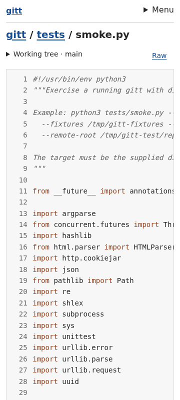

# gitt

A standalone browser for local Git repositories. Read code, compare changes, and create empty repositories from a phone or desktop.



## Highlights

- Browse existing bare repositories and working checkouts without migration.
- Inspect files, branches, tags, history, commit diffs, and two-snapshot comparisons.
- See staged, unstaged, and nonignored untracked changes in a live checkout.
- Search repository names and file paths. Read Markdown, highlighted source, and raw files.
- Create empty bare repositories or checkouts, including grouped paths.
- Semantic HTML, small CSS, and no JavaScript, external fonts, or browser dependencies.
- One executable. No runtime Git, database, CGI, or companion service.

## Installation

Download the archive for your Linux machine from the [v0.1.0 release](https://static.terrytsai.dev/gitt/v0.1.0-20261113-08e8e2/):

| Architecture | Download |
| --- | --- |
| x86-64 | [gitt-0.1.0-linux-x86_64.tar.gz](https://static.terrytsai.dev/gitt/v0.1.0-20261113-08e8e2/gitt-0.1.0-linux-x86_64.tar.gz) |
| ARM64 | [gitt-0.1.0-linux-aarch64.tar.gz](https://static.terrytsai.dev/gitt/v0.1.0-20261113-08e8e2/gitt-0.1.0-linux-aarch64.tar.gz) |

Compare the archive's `sha256sum` with [SHA256SUMS](https://static.terrytsai.dev/gitt/v0.1.0-20261113-08e8e2/SHA256SUMS), then extract it. For x86-64:

```sh
tar -xzf gitt-0.1.0-linux-x86_64.tar.gz
mkdir -p "$HOME/.local/bin"
install -m 755 gitt-0.1.0-linux-x86_64/gitt "$HOME/.local/bin/gitt"
```

The release executables are statically linked with musl. Templates, styles, syntax grammars, Git support, and compression support are included.

## Usage

Choose an existing directory containing your repositories, or create an empty one:

```sh
mkdir -p "$HOME/repositories"
"$HOME/.local/bin/gitt" "$HOME/repositories"
```

Open <http://127.0.0.1:8080>. Use **Create repository** to create an empty repository, or put existing repositories in the directory using your normal tools. A structure such as this works:

```text
repositories/
  notes.git/           bare repository
  website/             ordinary checkout with .git/
  experiments/
    parser.git/        grouped bare repository
```

Discovery is recursive and stops at each repository. Symlink directories are skipped. A checkout edited in this directory shows its live files; a clone elsewhere does not appear here. Refresh or follow a link to see updates.

Open **Menu** for repository navigation. **Files** opens the working files of a checkout or the default branch of a bare repository. **Branches & tags** opens a committed snapshot. **Changes** separates staged, unstaged, and untracked content. **Compare** compares the two selected trees directly. Merge commits show their first-parent diff and all parent IDs.

On a file page, follow the linked path to its parent directory. Expand **Working tree** or **Snapshot** for repository details and the configured SSH clone URL; use **Raw** to download the file. These compact controls are in the current source and LAN preview; the published v0.1.0 archives use the earlier layout.

For LAN access, explicitly bind a network interface and set the URL people will use:

```sh
gitt /srv/git \
  --bind 0.0.0.0:8080 \
  --origin http://gitbox.local:8080 \
  --ssh-prefix ssh://git@gitbox.local/srv/git/
```

`--ssh-prefix` only displays clone URLs. Your SSH server, server-side Git installation, permissions, and keys handle clone/fetch/push. Omit the option if you do not have SSH transport configured. Checkout repositories retain Git's normal restrictions on pushing to the checked-out branch; use a bare repository for a shared push destination.

| Option | Default / behavior |
| --- | --- |
| `<repository-root>` | Required existing directory; the filesystem visibility boundary |
| `--bind <IP:port>` | `127.0.0.1:8080`; numeric IPv4 or IPv6 address |
| `--origin <http(s)://host[:port]>` | Bind URL; required for a wildcard bind or a different browser hostname |
| `--ssh-prefix <ssh://…/>` | No clone URL unless configured; include the trailing slash |
| `--initial-branch <name>` | `main`; can also be selected in the creation form |
| `--help`, `--version` | Show help or version |

There is no configuration database. See [OpenRC](deploy/gitt.openrc), its [configuration example](deploy/gitt.openrc.conf), or the [systemd example](deploy/gitt.service) to run a service. Use a dedicated unprivileged user and a shared group with access to the watched directory. These are examples to install and adjust; gitt does not install or enable a service.

## Requirements and access

- Linux with `openat2` and **Landlock ABI 3 or newer enabled**—normally Linux 6.2 or newer. Startup fails clearly when the kernel or container policy prevents confinement.
- Read access to the repositories; write access to their parent directory for creation. New repository directories use shared-group permissions. Existing permissions and ownership are preserved.
- A current browser. JavaScript is neither used nor required.

There are no application accounts. Anyone who can reach the configured origin can read and create repositories. Keep access on localhost or your intended trusted network. For a reverse proxy, set `--origin` to the external URL and preserve that URL's `Host` header; forwarded headers are not used. TLS and any access control belong at the proxy or network boundary.

The watched root is an explicit publication boundary. Tracked files and history remain visible even if their paths now match ignore rules. Nonignored untracked files are visible too. Repository hooks, executable filters, remote fetching, and symlink targets are never run or followed by gitt. Worktree files requiring Git clean/text conversion receive an explicit limitation instead of a false clean result.

## Limits

| Operation | Limit |
| --- | --- |
| Source preview / each diff side | 1 MiB and 20,000 lines |
| Syntax highlighting | 256 KiB; lines up to 8 KiB; bounded work with plain-text fallback |
| Committed raw file | 8 MiB; larger objects use local Git or SSH |
| Working-file raw download | Streamed through a checked descriptor |
| Rendered page | 2 MiB |
| Discovery | 10,000 directories, 1,000 repositories, 64 levels |
| List / history page | 200 entries / 50 commits |
| Concurrent work | 2 active operations, 4 waiting, 16 HTTP connections |

Limits and omitted results are shown in the page. Working-tree views are observations of files that may change while being read. A response timeout cannot interrupt an already-running native Git operation; its work slot stays occupied until it finishes. The separate 24 MiB native Git allocation budget is not a whole-process RSS cap.

Self-contained SHA-1 repositories with ordinary loose/packed objects and refs are supported. SHA-256, reftable, linked worktrees, separate Git directories, object alternates, sparse indexes, and split indexes are rejected with explanations. Submodule IDs and LFS pointer files can be inspected; their contents are not fetched.

Highlighting includes Rust, Python, C, C++, JavaScript, JSON, HTML, CSS, shell, YAML, Markdown, and SQL. Unknown languages and expensive inputs remain readable as plain text. Renames appear as additions and deletions. Search covers names and paths, not file contents.

## Performance

Measured for v0.1.0 on an i5-4570T with an SSD, using 300 repositories including one 1 GiB repository:

| Measurement | x86-64 release |
| --- | --- |
| Executable | 3.44 MiB |
| Idle RSS before / after browsing | 2.73 / 12.75 MiB |
| Peak RSS with three readers | 16.57 MiB |
| Startup to complete listing, worst of 10 | 272 ms |
| Slowest endpoint p95 | 91 ms |
| Idle CPU | No ticks observed in each 60-second window; ~0.0166% resolution |

Startup includes SSH launch overhead; filesystem caches were warm. Measured release results and the exact workload are recorded in [performance.md](docs/performance.md). The [benchmark guide](docs/benchmark-method.md) includes reproducible commands and explains cache, transport, and sampling effects. No measurements of emulated ARM performance are used as hardware claims.

## HTTP interface and scope

The HTTP interface serves HTML and raw files. There is no versioned REST/JSON API or HTTP Git transport. `GET /new` shows a form; its protected `POST` creates a repository and redirects to it. Other application routes are read-only. Do not treat internal form tokens or query parameters as a stable automation API.

Editing, staging, committing, renaming, deleting, importing remotes, accounts, issues, pull requests, CI, and agent-specific behavior are outside this release. Continue using normal Git and filesystem tools for those tasks.

## Build and test

The pinned Rust toolchain is 1.95.0. Building also needs a C compiler and `make` for bundled native dependencies; the application itself needs none of these tools at runtime.

```sh
cargo build --locked --release
cargo test --locked
cargo clippy --locked --all-targets -- -D warnings
```

For a standalone release, install the appropriate Rust musl target and provide a musl C toolchain:

```sh
rustup target add x86_64-unknown-linux-musl
CC_x86_64_unknown_linux_musl=musl-gcc \
  CARGO_TARGET_X86_64_UNKNOWN_LINUX_MUSL_LINKER=musl-gcc \
  sh scripts/build-release.sh x86_64-unknown-linux-musl
```

Use `aarch64-unknown-linux-musl` and the corresponding cross compiler for ARM64. The release script verifies that the result has no dynamic interpreter or shared-library dependencies. Git and Python are used only by fixture and integration-test scripts; browser checks additionally use Playwright. See the [benchmark guide](docs/benchmark-method.md) for functional and resource checks. The [verification record](docs/verification.md) lists release results.

[Requirements](docs/requirements.md) and [implementation decisions](docs/decisions.md) record the supported behavior and chosen limits.

## License

[MIT](LICENSE). Bundled dependencies and syntax grammars retain their own licenses; see [third-party notices](THIRD_PARTY_NOTICES.md).
